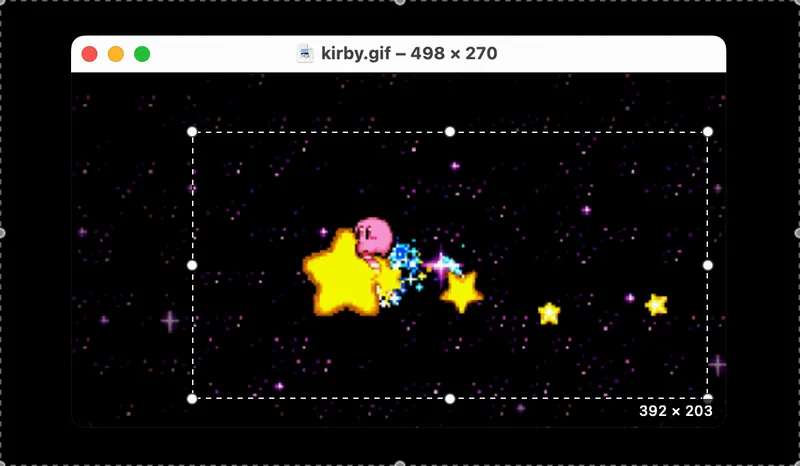

<p align="center"></p>

# GifCrop

A minimal macOS app for cropping animated GIFs, modeled on Preview's selection tool. Cropping is done by a bundled copy of [gifsicle](https://github.com/kohler/gifsicle).



## Installation

Requires macOS 12 or later. The app is universal, so the same download runs on Apple silicon and Intel Macs.

1. Download `GifCrop.zip` from the [latest release](https://github.com/evnoj/GifCrop/releases/latest)
2. Unzip it and move `GifCrop.app` to `/Applications`
3. Open it. GifCrop isn't signed with an Apple Developer ID, so macOS will refuse to open it the first time. Allow it in one of two ways:
   - Open System Settings → Privacy & Security, scroll down to the message about GifCrop, click "Open Anyway", and confirm
   - Or run `xattr -dr com.apple.quarantine /Applications/GifCrop.app` in Terminal

   Either way you only need to do this once.

To use GifCrop from the terminal, choose GifCrop → Install Command Line Tool…, which links `/usr/local/bin/gifcrop` to the tool inside the app.

## Usage

- Drag to select an area (the GIF keeps playing); drag inside the selection to move it, or drag a handle to resize it
- ⌘K crops, ⌘Z undoes
- ⌘S saves in place, ⇧⌘S saves to a new file
- ⌘A selects all, ⇧⌘A or Esc deselects, Shift-drag draws a square
- The Aspect Ratio menu locks the selection to a preset, the current selection's ratio, or your own custom presets

## Building

Requires Xcode (or the Command Line Tools with a macOS SDK), [mise](https://mise.jdx.dev), and an internet connection the first time, to download the gifsicle source.

```sh
mise install     # tools from mise.toml (gh, used by the release task)
mise run build
```

This builds a universal (Apple silicon + Intel) gifsicle from source into `build/gifsicle` (skipped when it's already up to date), builds the Swift package, and assembles an ad-hoc signed `build/GifCrop.app` with gifsicle, the `gifcrop` CLI, and the icon inside it.

Other tasks (`mise tasks` lists them all):

- `mise run install` — builds and copies the app to `/Applications`, replacing any existing copy
- `mise run package` — builds and zips the app into `build/GifCrop.zip` with `ditto`, which keeps the code signature intact
- `mise run release` — publishes a GitHub release for the version in `Support/Info.plist`

### Releasing

1. Bump `CFBundleShortVersionString` (following SemVer) and `CFBundleVersion` in `Support/Info.plist`
2. Add a `## [x.y.z]` section to `CHANGELOG.md`
3. Commit on `main`, then run `mise run release`

The release task refuses to run with uncommitted changes, off `main`, or if the tag already exists. It builds and packages the app, tags `vx.y.z`, pushes `main` and the tag, and creates the GitHub release with the changelog section, install instructions, and the zip's SHA-256.

## Layout

- `Sources/GifCrop/` — the app (AppKit, `NSDocument`-based)
- `Sources/GifCropCLI/` — the `gifcrop` command-line tool
- `Support/Info.plist` — app bundle metadata and version, registers GIF as an openable type
- `Support/AppIcon.png` — 1024px icon, converted to `.icns` during the build
- `mise.toml` — tool versions
- `mise-tasks/` — the build, package, install, and release tasks
